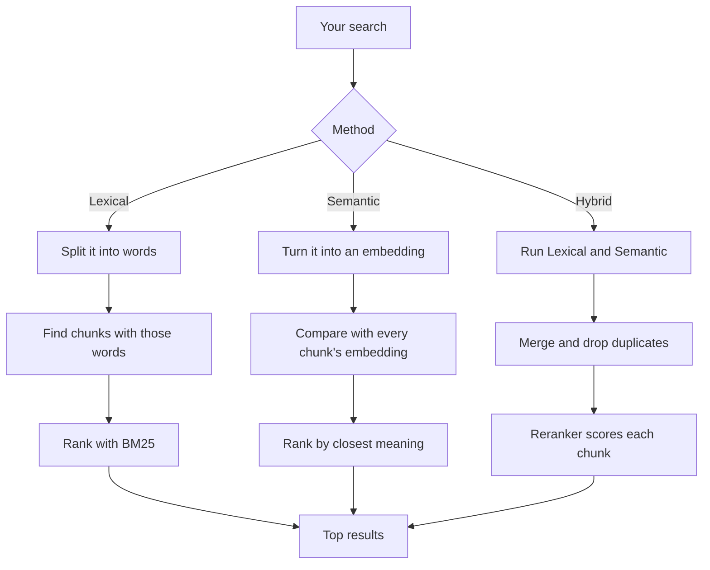

# Documents and search

## Adding a document

1. The app saves its own copy in `documents/`. Your original file is never touched, and adding
   the same file twice doesn't make a duplicate.
2. It pulls out the text:

   | Type             | How                                              |
   | ---------------- | ------------------------------------------------ |
   | PDF              | Text layer, plus OCR for images and scans        |
   | Word, PowerPoint | Converted to PDF first                           |
   | Excel, CSV       | Cell and row data                                |
   | Text, Markdown   | Read as-is                                       |
   | Audio            | Transcribed on your machine, with speaker labels |
   | YouTube          | The video's captions                             |

   PDF text is cleaned before chunking: running headers and footers that repeat on most pages
   are removed, tables already present in the page text are not indexed twice, and a sentence
   cut by a page break is kept whole on the page where it starts.

   With **Settings → Documents → Structure-aware parsing** on, each PDF page is rendered and run
   through Docling's Heron layout model (ONNX, in a worker thread) to find text blocks, section
   headings, tables, pictures and page furniture. A TypeScript port of Docling's layout
   post-processing and rule-based reading order turns those boxes into text in reading order:
   chunks start at section headings, tables become their own chunks, and headers, footers and
   text inside pictures are dropped. Pages the model can't handle fall back to the plain text
   layer. The code is in `src/lib/server/rag/chunk/layout/`.

   Structure-aware parsing also gives every chunk a **section path**, for example
   `Chapter 1 OVERVIEW > 1.4. Preparing and Processing Evaluations`. When the PDF has a
   bookmark outline that covers the document (at least one bookmark per 25 pages), the
   bookmarks are the sections: each one is placed on the line it points at, a new chunk starts
   there, and its outline depth is its level. Otherwise the detected section headings are used:
   "Chapter/Part/Section/Attachment/Appendix/Annex N" headings open the top level, dotted
   numbers nest by their number of parts, and other headings nest by font size. The path is
   stored in `document_chunks.section_path` and is used in four places:
   - it is prepended to the chunk when it is embedded
   - it is a second column of the keyword index, weighted at half of the content
   - the reranker sees it in front of the chunk
   - the assistant sees it in brackets before each passage, and citations name the innermost
     section

   Plain parsing doesn't set section paths.

3. It cuts the text into **chunks** of about 1,200 characters. Each chunk remembers its page,
   sheet or timestamp, which is how answers link back to the exact spot.
4. Chunks go into a keyword index and get an **embedding** for meaning search. CSV files are
   keyword-only. See [Embeddings and models](EMBEDDINGS.md).

## Searching

Only **active** documents are searched.

| Method       | Good for                        |
| ------------ | ------------------------------- |
| **Lexical**  | Names, codes, exact phrases     |
| **Semantic** | Questions in your own words     |
| **Hybrid**   | Almost everything (the default) |

The code is in `src/lib/server/documents/` (adding files) and `src/lib/server/rag/` (chunking,
embeddings and search).

Return to [docs](README.md).
